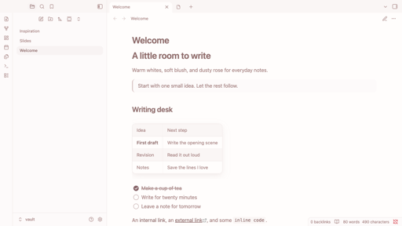

# Rose Blush

Rose Blush is a soft, warm theme for writing in Obsidian. Light mode pairs warm white with dusty rose. Dark mode uses warm charcoal with soft rose text.

- Rounded tables with everyday-weight headers and alternating blush and white rows starting at the header in light mode
- Circular checkboxes and rounded switches
- Compact pinned tabs with their own icons
- Warm-white, left-aligned presentations in light mode with Obsidian’s core Slides feature

Rose Blush uses system fonts and works offline. It runs on its own, with no community plugins or CSS snippets required.

[See Rose Blush in dark mode](screenshots/dark.png)

## Manual installation

1. Create a folder named `Rose Blush` inside your vault’s `.obsidian/themes` folder.
2. Copy `manifest.json` and `theme.css` into that folder.
3. Open **Settings → Appearance → Themes**, then select **Rose Blush**. Reload Obsidian if it doesn’t appear immediately.
4. Choose a light or dark base color scheme under **Appearance**.

The release targets Obsidian 1.15.0 or later. See the [release checklist](docs/RELEASING.md) for compatibility testing and screenshot guidance.

## License

[MIT](LICENSE) © 2026 Kimber
